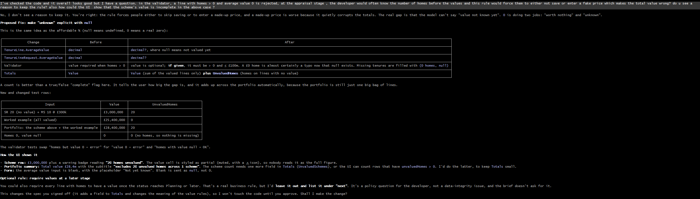
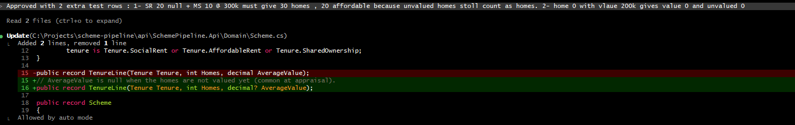
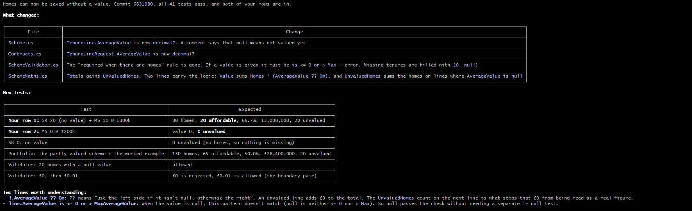
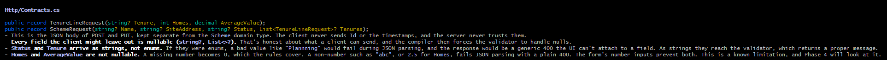
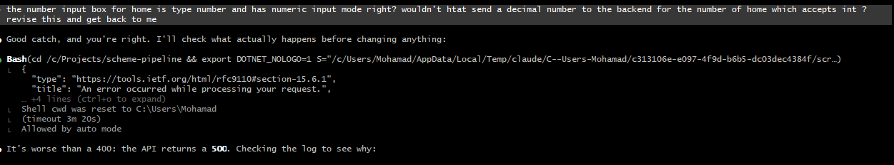
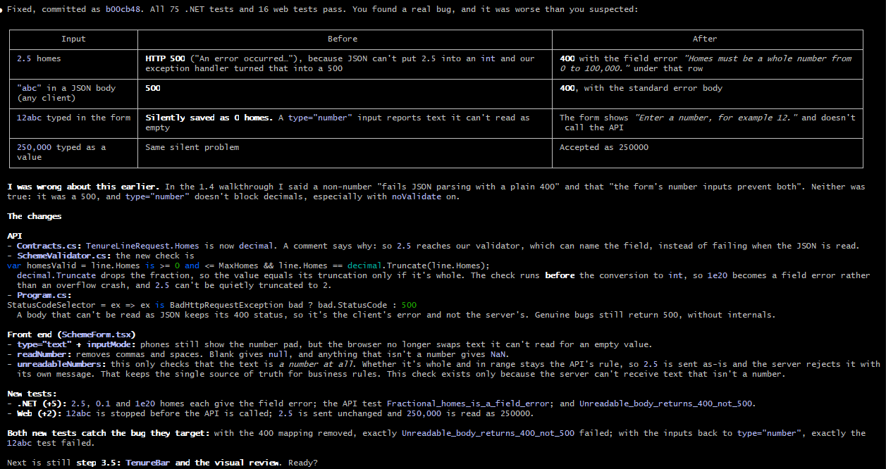
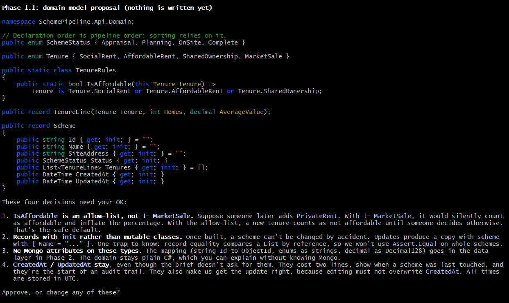
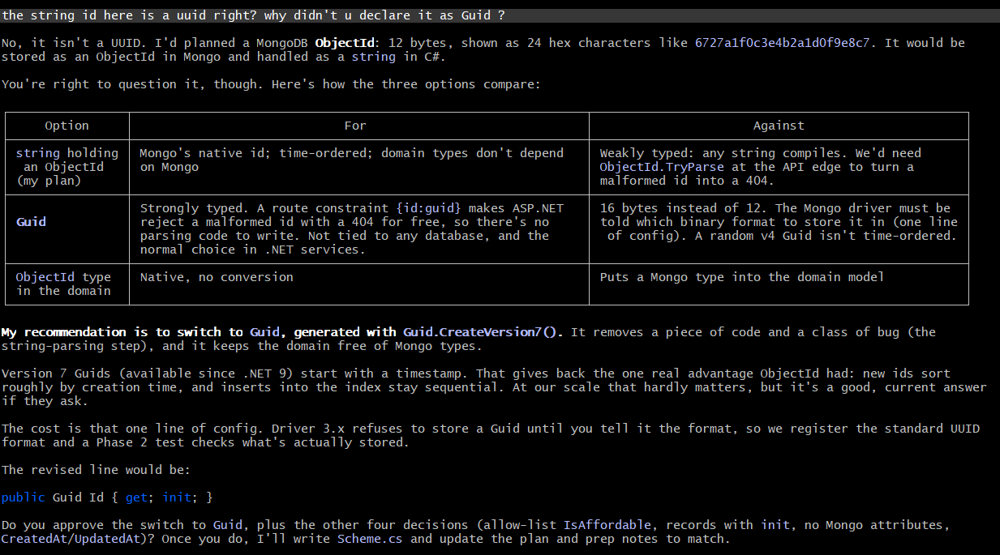
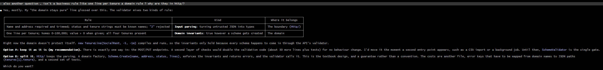

# Screenshots of the interactions that mattered

Taken from the builder sessions (Claude Code). Commit hashes in the screenshots are from before I rewrote the author email on 2026-11-04; the current hashes are given below.

## 1. My pushback that changed the design: unvalued homes (04 → 05 → 06)

- **04-appraisal-pushback.png:** I challenge the rule "average value required when homes > 0": at appraisal a developer knows the home count before the values, so it forces a fake price. The builder agrees and proposes `null` for "not valued yet" plus an `UnvaluedHomes` count, and won't change the signed-off spec until I approve.

  

- **05-appraisal-approved.png:** I approve with two extra test rows of my own: unvalued homes still count as homes and affordable, and 0 homes with a value gives value 0.

  

- **06-appraisal-done.png:** done, with my two rows in the test table. The screenshot says commit `6631980`; it is now **`dcb5608`**.

  

## 2. Output I rejected: "a plain 400" was really a 500 (03 → 08 → 09)

- **03-builder-claim-plain-400.png:** the builder's claim during the validator walkthrough: a non-number or 2.5 for Homes "fails JSON parsing with a plain 400. The form's number inputs prevent both."

  

- **08-number-input-500.png:** I question it ("wouldn't that send a decimal number to the backend for the number of homes, which accepts int?"). It runs the real API: HTTP 500.

  

- **09-i-was-wrong.png:** "I was wrong about this earlier." It was worse than a 400: 2.5 gave a 500, and `12abc` was silently saved as 0 homes. Fixed with tests that each catch their bug. The screenshot says commit `b00cb48`; it is now **`06fac9c`**.

  

## 3. My question that changed the design: the id type (01 → 02)

- **01-guid-proposal.png:** the proposed domain model, with `string Id`.

  

- **02-guid-switch.png:** I ask why the id is a string and not a `Guid`. It explains it had planned a Mongo ObjectId, compares the options and recommends `Guid.CreateVersion7()`, which I approved (commit `8239b66`).

  

## 4. Backup: a domain rule in the wrong layer (07)

- **07-domain-rule-question.png:** I ask why "one line per tenure" lives in `Http/` rather than the domain. It concedes that its "the domain stays pure" line glossed over this, and gives two options. I kept one validation gate, with a stated trigger for splitting it (a second entry point such as an import job).

  

